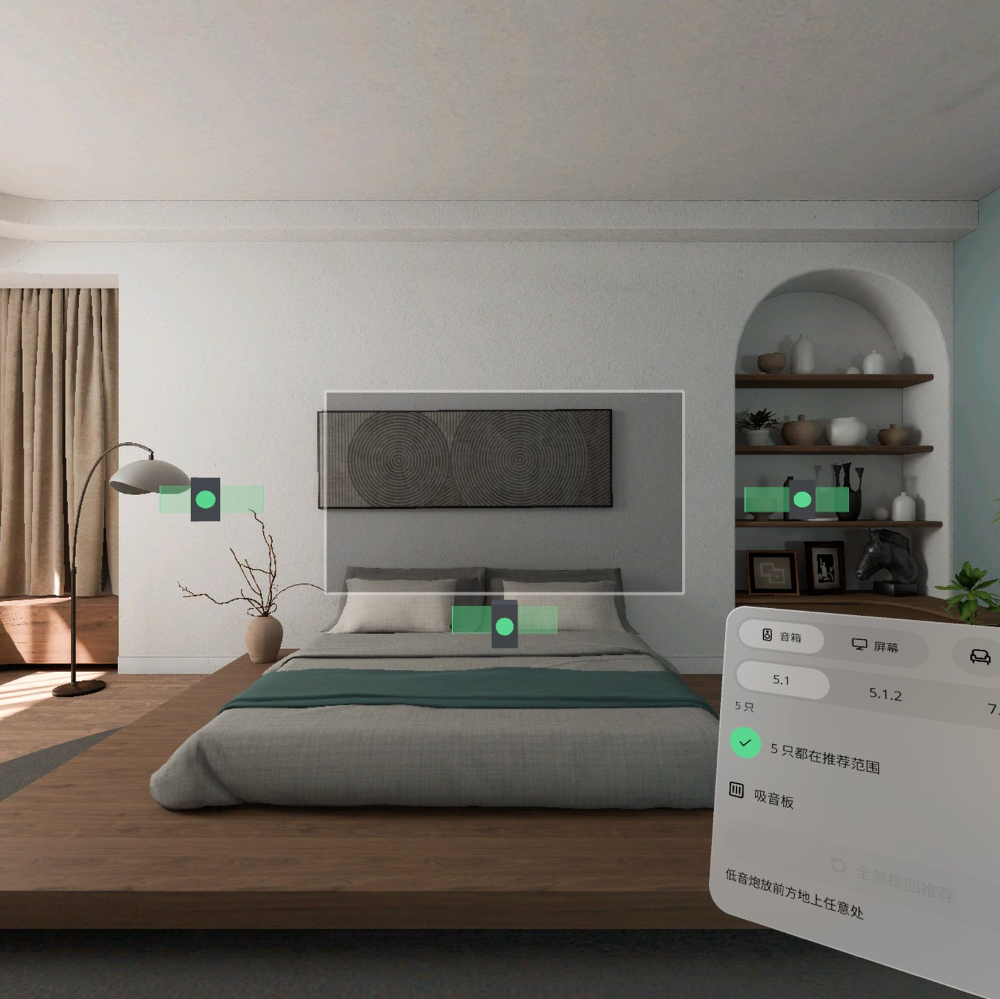

<p align="center"></p>

# Theater Planner | 影院规划

**坐到你的沙发上捏一下，5.1 / 5.1.2 / 7.1.4 音箱该装哪、电视多大、投影机吊哪、吸音板贴哪，直接亮在你家墙和天花板上。**

**Sit on your sofa and pinch: where each 5.1 / 5.1.2 / 7.1.4 speaker goes, how big the TV should be, where the projector hangs and where the absorbers stick — drawn straight onto your real walls and ceiling.**

PICO OS 6 · PICO Spatial SDK 6.1 · Kotlin / SpatialUI · package `io.embodit.theaterplanner` · v0.1.0 (pre-release / 预发布)



> 演示截图来自原生模拟器（PICO Emulator 6.1），由调试广播驱动跳转到各设计状态；**非真实手势录像**。
> Screenshots were taken on the native PICO emulator, driven by debug broadcasts that jump to each design state; **not a recording of real hand gestures.**

---

## 中文

### 这是什么

装修或买音响之前，坐在自家客厅沙发上把家庭影院规划一遍。你坐下时的头就是听音位，耳高自动得到；每只音箱按杜比推荐角度落到你家真实的墙或天花板上，墙上画绿色推荐带、天花板画绿区，转头就能看到。拖动音箱沿墙滑动，出了推荐带会变红并提示「往右 32 cm」。屏幕页把 1:1 的电视或投影幕放到前墙上并给出视角判断，投影机按投射比吊在你的天花板上，吸音板开关标出第一反射点。

### 安装与启动

```bash
adb install -r TheaterPlanner-v0.1.0.apk
pico-cli app launch io.embodit.theaterplanner
```

APK 在 [Releases](https://github.com/kejing-dev/TheaterPlanner/releases) 页面下载（仓库不含 APK）。需要 PICO OS 6 头显或 PICO Emulator 6.1，并授予平面识别 / 空间锚点权限。

### 容器与骨架

- **容器**：只有 Full Space · `STAGE_MIXED`（透视），没有 Shared Space 版本。音箱、屏幕、吸音板都要落在真实的墙和天花板上，依赖平面识别（FLOOR / WALL / CEILING）、头部位姿和世界锚点，这些只在 Full Space 可用。
- **骨架 D**（参考空间尺 Spatial Ruler → 家具试摆 Furniture Fit）：预建面板池、Stage 根实体、平面碰撞体与后挡板、世界锚点、手势转换（DragLine）、懒跟随、主题与字体、调试接收器、摇杆输入。所有 3D 计算（落点、角度、反射点、投影位置）在纯 Kotlin domain 层，ECS 只读结果。
- **状态**：设计包 S01–S27 共 27 个状态，全部可由调试广播直接跳转并截图。

### 截图

| | |
|---|---|
|  |  |
| 5.1.2 — 仰头看天花板上的顶置音箱绿区 | 拖动中 — 读数牌实时显示角度与偏移 |
|  |  |
| 超出范围 — 音箱变红，提示「往右 … cm」 | 吸音板 — 蓝色 60 cm 方框标出第一反射点 |
|  |  |
| 屏幕·电视 — 1:1 电视矩形与「视角 36° · 合适」 | 屏幕·投影 — 幕布、吊装投影机与投射比 |

启动器图标：


### 已知问题（QA 第 1 轮进行中）

- 中文字体子集缺「绕」「侧」两字，这两个字会回退到系统字体，字形与其余文字略有差异。
- HOME 键在模拟器上先弹出系统「Back to Home」确认框，再退出应用。
- 摇杆交互（左右转动音箱并吸附到推荐位）在模拟器上没有手柄、未验证；真机未验证。
- QA 第 1 轮仍在模拟器上进行，未完成的检查项会在后续轮次补充；真机验收未做。

---

## English

### What it is

Plan a home theater from your own sofa before drilling holes or buying speakers. Your head when you sit down is the listening position (ear height comes for free). Each speaker of a 5.1 / 5.1.2 / 7.1.4 layout lands on your real wall or ceiling at the Dolby recommended angle, with a green recommended band on each wall and a green zone on the ceiling. Drag a speaker along the wall; it turns red outside its band with a "move right 32 cm" hint. The screen page puts a 1:1 TV or projection screen on the front wall with a viewing-angle verdict, hangs the projector from your ceiling at the throw distance, and the absorber switch marks the first-reflection points.

### Install and launch

```bash
adb install -r TheaterPlanner-v0.1.0.apk
pico-cli app launch io.embodit.theaterplanner
```

Download the APK from the [Releases](https://github.com/kejing-dev/TheaterPlanner/releases) page (the repository itself does not ship an APK). Needs a PICO OS 6 headset or PICO Emulator 6.1 with plane-detection / spatial-anchor permission.

### Container and skeleton

- **Container**: Full Space only, `STAGE_MIXED` (passthrough); no Shared Space version. Speakers, screen and absorbers must land on real walls and ceiling, which needs plane detection (FLOOR / WALL / CEILING), head pose and world anchors, all Full Space only.
- **Skeleton D** (from Spatial Ruler → Furniture Fit): pre-built panel pool, Stage root, plane colliders + backstop, world anchors, gesture conversion (DragLine), lazy follow, theme and fonts, debug receiver, thumbstick input. All 3D maths (landing points, angles, reflection points, projector position) lives in a pure Kotlin domain layer; the ECS only reads the results.
- **States**: 27 design states S01–S27, each reachable and capturable through debug broadcasts.

### Screenshots

See the gallery above: 5.1.2 ceiling zones, dragging with the live readout, out-of-range (red) hint, absorbers, TV screen with the viewing-angle verdict, and the projector with its throw distance.

### Known issues (QA round 1 in progress)

- The subset Chinese font lacks the glyphs 「绕」 and 「侧」; those two characters fall back to the system font and look slightly different.
- On the emulator the HOME key first shows the system "Back to Home" confirmation before the app exits.
- Thumbstick interaction (turning a speaker along the wall and snapping to the recommended spot) is unverified: no controller on the emulator, and no real-device test yet.
- QA round 1 is still running on the emulator; unfinished checks will be covered in later rounds. No real-device acceptance yet.

## License

Private repository; all rights reserved. 私有仓库，保留所有权利。
